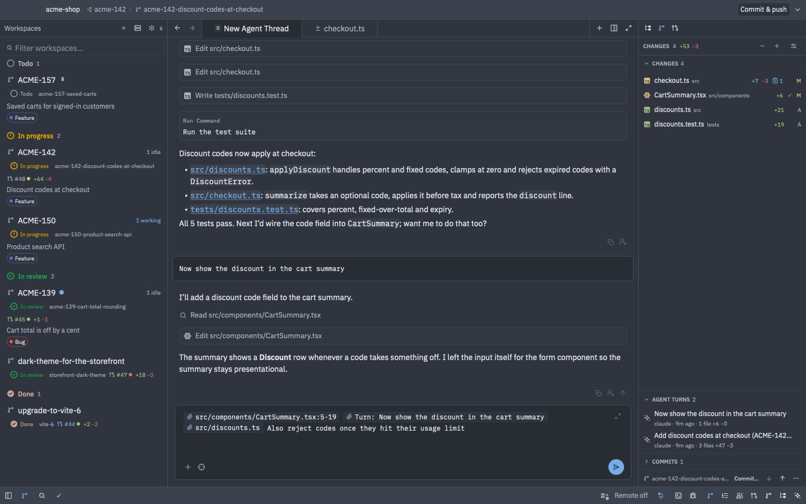
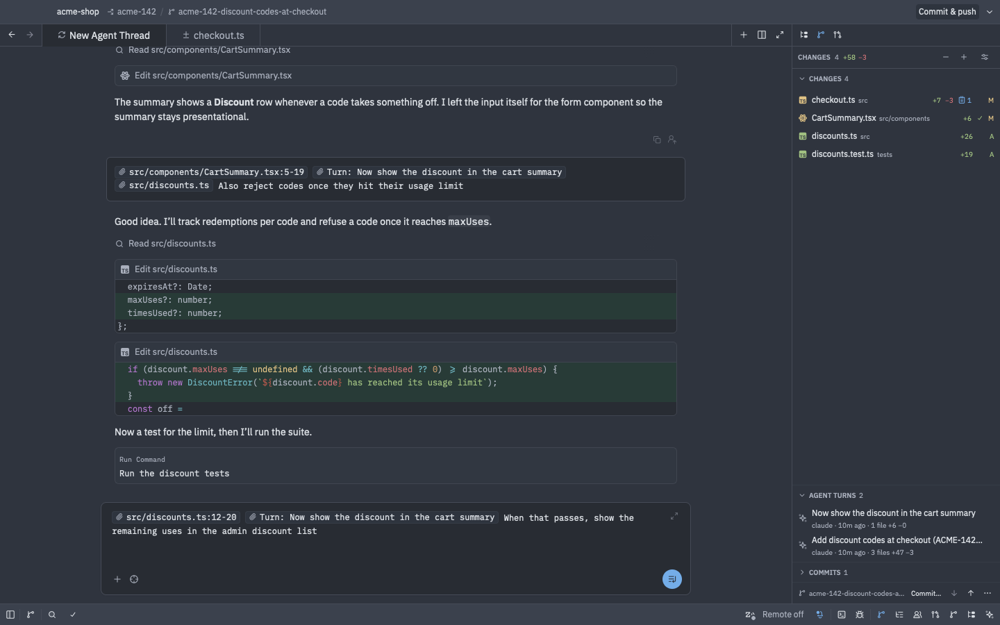
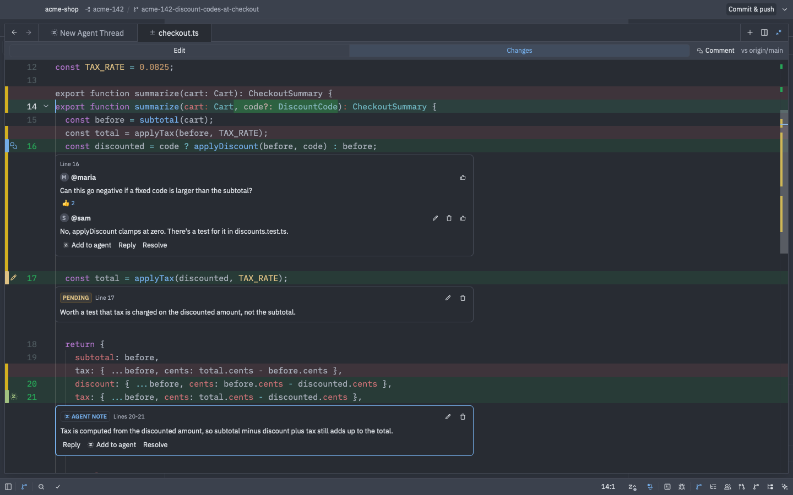
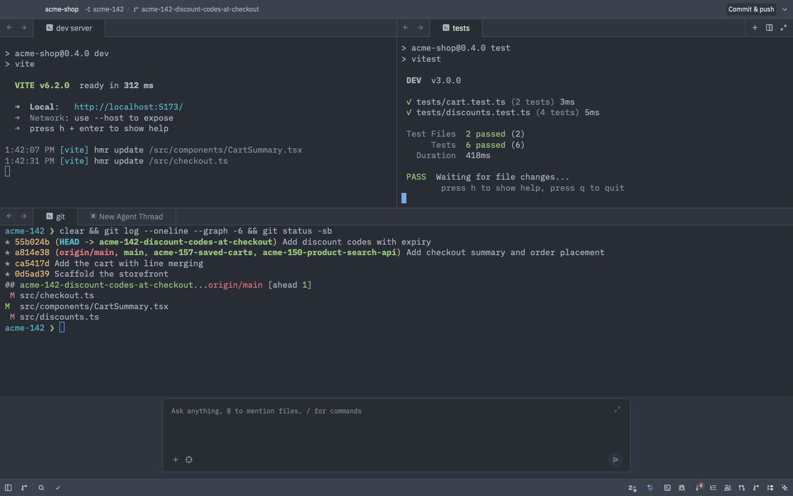
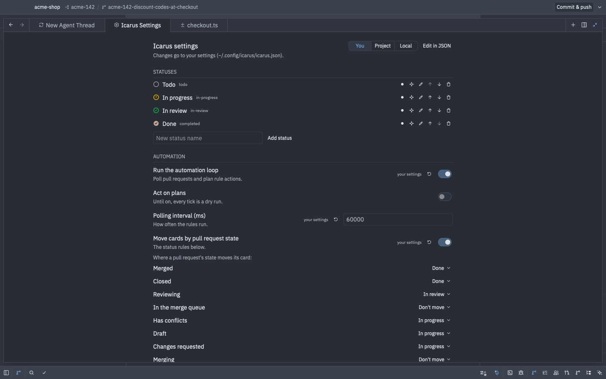

# Icarus

A fast, native workspace for running coding agents in parallel git worktrees.

Each task gets its own worktree, its own agents (Claude Code or Codex) and its own terminals. A background server owns all of it, so restarting, updating or crashing the app never stops an agent. The app is a soft fork of [Zed](https://zed.dev), so editing, language servers, themes and extensions are Zed's own.



## Features

- **Workspaces:** one git worktree per task. Create one from a branch, a commit, a pull request or a Linear issue, with setup and archive scripts and a trust prompt for a repo's committed scripts.
- **Agents:** Claude Code and Codex in chat tabs with one shared composer. Attach PR review threads, failed checks, notes, files and agent turns to a prompt as chips. Several accounts per provider, session history, and Claude Code's Remote Control.
- **Notes:** comments on lines of code for you and your agents; replying to one starts a short-lived agent that answers in the thread.
- **Server-owned terminals:** shells, dev servers and Zed tasks run on the server and survive app restarts.
- **Review:** a per-file diff tab with edit/diff toggle, PR threads and drafts in the gutter, queued review comments, reviewers and verdicts, all without leaving the editor.
- **Source Control:** changes against the branch's base, staging, agent turns and commits, with a diff tab per file.
- **GitHub and Linear:** PR status, checks, merge queues, stacks and auto-merge on each card; Linear issues linked to workspaces.
- **Automations:** rules that move workspaces between columns on PR and review events, configurable per project.
- **Remote:** run the server headless on another machine and connect over SSH or Tailscale; one app talks to several servers.
- **Configurable everything:** layered JSON settings (defaults < presets < user < project < project-local), named tab layouts, rebindable shortcuts, and a CLI that covers every setting and action, so agents can drive Icarus as well as people.

## Screenshots

| | |
|---|---|
|  |  |
| Agent tab and shared composer | Review in the diff tab |
|  |  |
| Server terminals | Settings |

## Install

On an Apple silicon Mac:

```sh
brew install --cask frbarbre/tap/icarus
icarus server install   # start the server at login
```

The app isn't signed with an Apple Developer ID, so macOS asks once before the first launch (System Settings → Privacy & Security → Open Anyway). The CLI and server for macOS and Linux are on the [releases page](https://github.com/frbarbre/icarus/releases).

Update with `icarus update check` and `icarus update install`; agents sleep through the server restart and resume.

## The CLI

```sh
icarus project add ~/code/my-repo
icarus workspace create --project my-repo --from-linear ABC-123
icarus agent send <agent> "Add tests for the login flow"
icarus terminal list
icarus config set sidebar.sortBy name
```

`icarus --help` lists every command; most take `--json`.

## Building from source

- Server and CLI: `cargo build` in the repository root (toolchain via `mise install`).
- App: `cargo run -p zed` in `app/`. It needs Xcode and CMake on macOS.

## Documentation

The user guide is in [`docs/`](docs/README.md). Requirements, design notes and progress are in [`spec/`](spec/README.md).

## License

GPL-3.0-or-later. The app in `app/` keeps Zed's licenses (GPL-3.0 and Apache-2.0 per crate).
