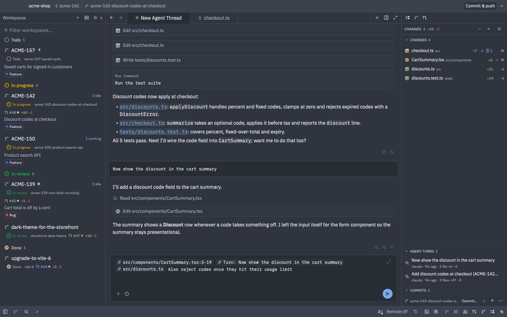

# Icarus documentation

Icarus is a native workspace for running coding agents (Claude Code and Codex) in parallel git worktrees. A background server owns every agent, terminal and automation. The app is a soft fork of [Zed](https://zed.dev), and the `icarus` CLI can do everything the app does.

## Guides

- [Getting started](getting-started.md): install, update, add a project, create your first workspace, and find your way around the window.
- [Workspaces](workspaces.md): creating workspaces, setup and archive scripts, the sidebar, cards, sleep and delete, layouts.
- [Agents](using-agents.md): agent tabs, the shared composer and attachments, notes, accounts, Claude Code and Codex, Remote Control.
- [Terminals](terminals.md): server-owned terminals, tasks, splits, quick commands, ports, and `icarus terminal`.
- [Review](review.md): diff tabs, reviewing pull requests, and the Source Control panel.
- [GitHub and Linear](github-and-linear.md): pull request status, checks, merge queues, stacks, auto-merge, previews and Linear issues.
- [Automations](automations.md): statuses, rules and presets.
- [Remote servers](remote.md): headless servers, pairing, Tailscale and SSH, SSH projects.
- [Settings](settings.md): settings layers and files, `icarus config`, importing from Zed, language servers.
- [Keyboard shortcuts](shortcuts.md): the default shortcuts and how to rebind them.
- [CLI reference](cli.md): every command, with examples.

## Where things live

| What | Where |
|---|---|
| Server state (database, logs of agent sessions, terminals) | `~/.icarus` (`--home` or `ICARUS_HOME`) |
| Your settings | `~/.config/icarus/icarus.json` |
| A project's shared settings | `icarus.json` in the repository root |
| A project's local settings | `icarus.local.json` in the repository root |
| Saved remote servers | `~/.config/icarus/servers.json` |
| The app's Zed settings, keymap and themes | `~/.config/icarus/settings.json`, `keymap.json`, `themes/` |
| New worktrees | `~/icarus/workspaces/<project>/<workspace>` (`workspace.root` setting) |

The design notes and requirements behind Icarus are in [`spec/`](../spec/README.md).
