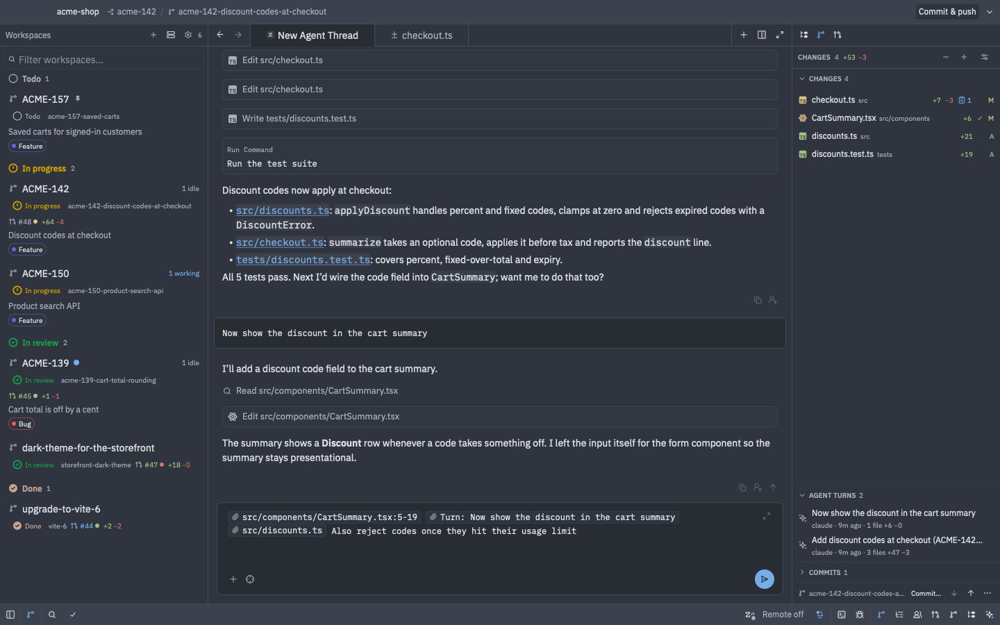

# Getting started

## Install

### macOS (Apple silicon)

```sh
brew install --cask frbarbre/tap/icarus
icarus server install
```

The cask installs `Icarus.app` into `/Applications` and puts the `icarus` CLI and `icarus-server` on your `PATH`. `icarus server install` starts the server now and at every login (a launchd agent). The app doesn't start the server itself, so run this once.

The app isn't signed with an Apple Developer ID, so macOS blocks the first launch. To open it:

1. Open Icarus once and dismiss the warning.
2. Open System Settings → Privacy & Security.
3. Choose **Open Anyway** next to the message about Icarus.

macOS remembers the choice.

### Linux, and the CLI on its own

The [releases page](https://github.com/frbarbre/icarus/releases) has tarballs of `icarus` and `icarus-server` for Linux (x86_64 and aarch64) and a universal one for macOS. There is no Linux app yet: on Linux you run the server and CLI, and connect to it from a Mac (see [Remote servers](remote.md)).

```sh
tar -xzf icarus-<version>-x86_64-unknown-linux-gnu.tar.gz
mv icarus-<version>-x86_64-unknown-linux-gnu/icarus* ~/.local/bin/
icarus server install   # a systemd user unit
```

### What you also need

- `git`.
- [Claude Code](https://docs.anthropic.com/en/docs/claude-code) (`claude`) and/or [Codex](https://github.com/openai/codex) (`codex`), signed in. Icarus runs your own binaries with your own login and never reads their credentials.
- The GitHub CLI `gh`, signed in (`gh auth login`), for pull requests, checks and reviews.
- Optional: a Linear API key for Linear issues (see [GitHub and Linear](github-and-linear.md#linear)).

Check that the server runs:

```sh
icarus server status
```

## Update

```sh
icarus update check     # compare the running version with the newest release
icarus update install   # install it and restart the server
```

`icarus update install` runs `brew upgrade --cask icarus` for Homebrew installs. Otherwise it downloads the release, checks it against `SHA256SUMS`, and swaps in the app or the binaries (keeping the old copy as `*.previous`). During the restart, terminals keep running and agents sleep, then resume on their next message.

The server checks for new releases every 6 hours and sends an "Update available" notification once per version. The app shows it with a **Restart to update** button. To turn the background check off:

```sh
icarus config set updates.channel none
```

## Add a project

A project is a git repository Icarus creates worktrees from.

In the app, open the **+** menu at the top of the Workspaces panel and choose **Add Project…**, then pick the repository folder. The dialog shows what Icarus detected (repository root, remote, default base branch). You can change the name and the base.

From the shell:

```sh
icarus project add ~/code/my-repo
icarus project add ~/code/my-repo --name my-repo --base origin/main
icarus project list
```

## Create your first workspace

A workspace is one git worktree with its own branch, agents and terminals. Every workspace starts with an agent.

1. Press ⌘⇧N (Ctrl+Shift+N on Linux), or choose **New Workspace…** from the **+** menu.
2. Type a name. The branch defaults to the name.
3. Pick the project, where to start from, and the agent (Claude or Codex).
4. Choose **Create**.

Icarus creates the worktree under `~/icarus/workspaces/<project>/<name>`, runs the project's setup script if it has one, and opens the workspace with an agent tab. Type a prompt into the composer at the bottom and press Enter.

From the shell:

```sh
icarus workspace create --project my-repo add-login-tests --prompt "Add tests for the login flow"
```

See [Workspaces](workspaces.md) for start points, scripts and the sidebar.

## The window



| Area | What it shows |
|---|---|
| Workspaces panel (left) | Every workspace as a card, grouped and sorted as you choose. Click a card to open it. See [the sidebar](workspaces.md#the-sidebar). |
| Centre panes | Agent tabs, diff tabs, files, terminals and browser tabs. Split and drag them like any Zed tab. |
| Composer (bottom of the centre) | Types into the active agent tab, or the last agent you used. See [Agents](using-agents.md). |
| Source Control panel (right) | The workspace's changes against its base, agent turns and commits. See [Review](review.md#source-control). |
| GitHub panel (right) | The pull request: status, stack, merge queue, checks, reviewers, previews and the Review section. See [GitHub and Linear](github-and-linear.md). |
| Title bar | The next-action button (Create PR, Commit & push, Merge, …), and buttons for the running frontend and the PR's preview. |
| Status bar | The notification bell, the agent account's usage meter, and the active agent's Remote Control state. |

Everything else is Zed: the project panel, editor, search, language servers, themes and extensions work as they do in Zed. The command palette is ⌘⇧P (Ctrl+Shift+P); every Icarus action is in it under `icarus:`.

## Notifications

The server sends a notification when an agent finishes its turn, waits for you, or fails; when CI fails on a workspace's pull request; when someone requests your review; when a pull request merges; and when a new release is out.

- While an Icarus window is in front, a notification is a toast with **Open**, which jumps to the workspace (and the agent's tab).
- Otherwise it's a system notification with a sound. The Dock icon shows the unread count.
- The bell in the status bar lists the 50 most recent, with **Mark all read** and **Clear**.

Turn kinds off in Settings → Notifications, or with `icarus config set notifications.<kind> false` (kinds: `agent_turn_done`, `agent_waiting`, `agent_failed`, `ci_failed`, `review_requested`, `pr_merged`, `rules`, `update_available`). `notifications.enabled` and `notifications.sound` switch everything or the sound.

From the shell:

```sh
icarus notifications --unread
icarus notifications read --all
```

## Coming from Zed

On first launch, if you have Zed installed, the app offers to import your Zed settings, keymap, theme and extensions. See [Settings](settings.md#importing-from-zed).
