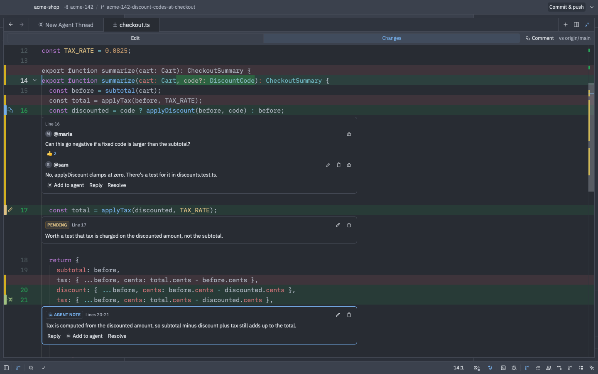
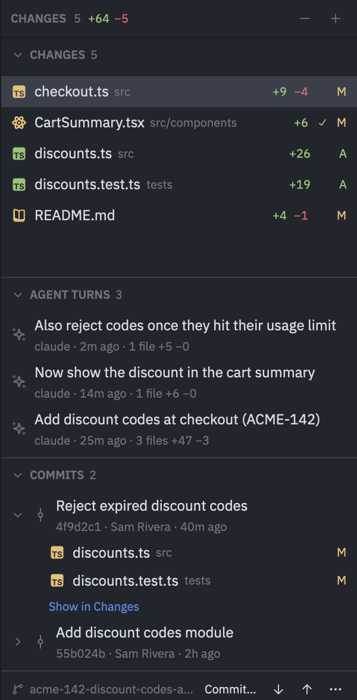

# Review

Icarus lets you read and review an agent's work, and other people's pull requests, without leaving the editor.

## Diff tabs



Click a file in the Source Control panel to open its diff tab: the file's changes against the workspace's base, in a full editor with language support.

| Action | macOS | Linux |
|---|---|---|
| Show the diff of the active file | ⌥⌘D | none |
| Switch a diff tab to the editable file | ⌥⌘E | none |
| Next / previous change | F7 / ⇧F7 | F7 / Shift+F7 |
| Next / previous changed file | ⌥F7 / ⌥⇧F7 | Alt+F7 / Alt+Shift+F7 |
| Comment on the selected lines | ⌘⇧A | Ctrl+Shift+A |

Next and previous change stop at the first and last change; a change taller than the window pages through it. They also work when focus is outside an editor (they act on the open diff). A single press of next/previous changed file wraps around the list; holding the key stops at the ends.

## Review a pull request

Open the workspace of the pull request (for someone else's PR, create a workspace from it: see [Start from a pull request](workspaces.md#start-from-a-pull-request)). Then:

- PR review threads show at their lines in diff tabs and plain file editors. Outdated threads collect at the end of the file; resolved ones collapse to one line. Each has **Reply**, **Resolve** / **Unresolve**, reactions, and **Add to agent**.
- Rows with a thread, a pending comment or a note get a coloured strip (blue, amber, green) and an icon in the gutter. Click the icon to scroll to the card.

### Write comments

1. Select lines, click the **+** that appears in the gutter, or drag over gutter rows.
2. Press ⌘⇧A (Ctrl+Shift+A), or choose **Comment** in the diff tab's header.
3. Make sure **Add to review** is picked in the box's header (the other side, **Agent**, writes a [note](using-agents.md#notes)).
4. Type, then:
   - **Add to review** (⌘Enter) queues it as a draft in your pending review. It shows inline with a PENDING badge.
   - **Comment now** posts this one comment to GitHub straight away.

Escape cancels. Comment boxes complete `@` mentions (the PR's author and the repository's assignable users) and `:emoji:` shortcodes. To add an image or video, choose **Image or video**, paste, or drop a file; it uploads to GitHub and inserts the markdown.

Your own published comments can be edited or deleted. Drafts can be edited or deleted until you submit.

Comments on lines outside the PR's diff become file comments that quote the code.

### The Review section

The GitHub panel's Review section holds the rest of the review:

- **Reviewers**: everyone requested and everyone who reviewed, with their verdicts. Remove an unanswered request, or re-request someone who already reviewed.
- **Request a review**: type a login or `org/team` and press Enter, or use the people button to pick from suggestions (GitHub's suggested reviewers, then frequent reviewers in the repository).
- **Diff base**: what the diffs compare against. "Since your last review" shows only what changed since you last reviewed, even after a rebase. You can also pick a commit or the whole PR.
- **Summary**: the review's body, saved as you type.
- **Verdict**: **Only comment**, **Approve** or **Request changes**, with the number of queued comments. On your own PR only "Only comment" is offered.

Submitting sends one GitHub review with every draft. If GitHub refuses it, the drafts stay and GitHub's message is shown.

Drafts live on the server, keyed by the pull request, so they survive restarts and new pushes. A workspace with unsent drafts isn't deleted by hand (without force) or by automations.

### From the shell

The `review` commands work on the workspace containing the current directory, or `-w <workspace>`.

```sh
icarus review show
icarus review threads --unresolved
icarus review comment add --file src/auth.ts --line 42 --end-line 48 --body "Can this loop forever?"
icarus review comment add --file src/auth.ts --line 10 --body "Typo" --now
icarus review comment list
icarus review reply PRRT_abc123 --body "Fixed in the latest push."
icarus review resolve PRRT_abc123
icarus review react PRRC_def456 +1
icarus review upload screenshot.png           # prints markdown to paste in a comment
icarus review base since-review
icarus review summary --body "Looks good apart from the retry." --verdict approve
icarus review submit
icarus review people --suggested
```

## Source Control



The Source Control panel (right dock) shows the workspace's work against its base branch.

### Changes

One list of every changed file since the branch left its base: committed, staged, unstaged and untracked changes merged into one row per file, with line counts. Click a row to open its diff tab.

- ⌥⌘U shows only uncommitted changes, and back (macOS).
- The filter menu ("Show file types and areas") hides kinds of files, such as generated files, tests, lint baselines or files that only change imports. Hidden kinds are saved per workspace and shared with every client.
- Hover a row for **Stage** (+), **Unstage** (−) and **Discard**. The header has **Stage all** and **Unstage all**. A check mark means fully staged; a dash, partly staged.
- **Discard** throws away only the uncommitted change: edits go back to the last commit, untracked files are deleted, a deleted file comes back. It asks first.
- Right-click a row for **Open Diff**, **Open File**, **Reveal in Project Panel**, **Copy Path**, **Copy Relative Path**, **Stage**, **Unstage**, **Discard**, **Open in** (another app) and **Reveal in Finder** (Open Containing Folder on Linux).

### Agent turns

Each agent turn that changed files is recorded as a snapshot (the newest 50 per workspace), without touching your git index. The Agent turns section lists them: the prompt, the agent, when, and how many files and lines. Click one to narrow the list to what that turn changed and open it in the commit view. ⌥⇧⌘T does this for the latest turn (macOS).

### Commits

The Commits section (collapsed by default) lists the commits on the branch since its base. Click one to see its files; click a file for its diff in that commit. **Show in Changes** narrows the list to the commit.

### Commit, push and pull

The git bar shows the branch, how far ahead or behind it is (or "not published"), and **Commit…**, **Pull** and **Push**. Its menu has **Sync** (pull, then push) and **Force push (with lease)**.

**Commit…** opens a small dialog: type the message, press ⌘Enter. It commits what's staged, or every change when nothing is. Tick amend to amend the last commit. Commit hooks run, and their output shows if they fail. Git errors are shown in git's own words.

The first push publishes the branch. A workspace branch starts out tracking its base, so pull and sync wait until it's published.

```sh
icarus git status
icarus git stage src/auth.ts
icarus git commit -m "Retry with backoff"
icarus git push
icarus git push --force-with-lease
icarus git discard src/scratch.ts
icarus git commits
icarus workspace turns fix-login
icarus changes list fix-login --scope turn:latest
icarus changes explain fix-login src/generated/api.ts   # why a file got its type
```

The `git` commands work on `--workspace`, else the workspace containing the current directory.

### Open in other apps

The **Open in** submenu lists the apps in `sourceControl.openIn` (VS Code by default). **Customize apps…** at its end opens Settings → Source Control to edit the list. A command runs with the file's path as its last argument; a command with spaces runs through the shell.

```json
{
  "sourceControl": {
    "openIn": [
      { "id": "vscode", "label": "VS Code", "command": "code" },
      { "id": "cursor", "label": "Cursor", "command": "cursor" }
    ]
  }
}
```

### Sections

Click a section header to collapse it. Drag a header onto another to reorder, or use its menu (**Move Up**, **Move Down**, **Hide Section**). The panel header's Sections list shows hidden sections again. The layout is saved in `sourceControl.sections` (`order` and `hidden`, with the ids `changes`, `agent-turns` and `commits`).
