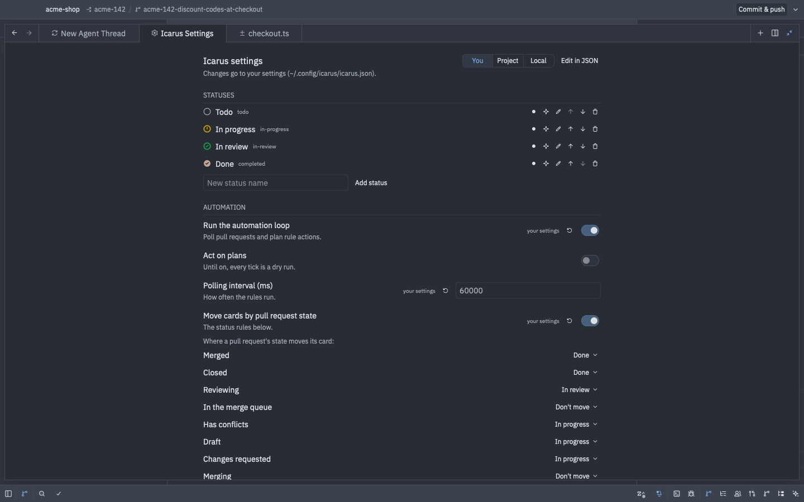

# Settings

Icarus has two kinds of settings:

- **Icarus settings** (workspaces, agents, automations, GitHub, Linear, …): layered JSON files the server reads. This page is mostly about these.
- **Zed settings** (editor, fonts, theme, language servers, keymap): the app's own Zed `settings.json` and `keymap.json` in `~/.config/icarus`. Open them with Zed's usual commands (`zed: open settings`, `zed: open keymap`).

## Layers

Icarus settings come from five layers. Later layers win:

| Layer | File | Notes |
|---|---|---|
| defaults | built in | |
| presets | built in | Named in your user settings' `presets` list. See [Presets](automations.md#presets). |
| user | `~/.config/icarus/icarus.json` | Yours, on this machine. |
| project | `icarus.json` in the repository root | Committed and shared with the team. |
| project-local | `icarus.local.json` in the repository root | Yours, for this repository. Add it to `.gitignore`. |

Objects merge key by key; arrays and plain values replace. `ICARUS_CONFIG_DIR` moves the user folder.

Some settings are only read from user settings: `presets`, `linear.api_key_command`, and `sourceControl.openIn`.

The files are validated against a schema: an unknown key or a wrong type is refused with the key and the reason. `icarus config schema` prints the JSON Schema, with a description of each key.

## The Settings tab



`icarus: open settings` opens the Icarus Settings tab. A **You / Project / Local** switch picks the layer edits go to. Each row shows which layer its value comes from, with a reset when it's set in the chosen layer, and **Edit in JSON** opens that layer's file.

Sections: Statuses, Automation, Pull request rules, Top bar action prompts, Agents, Integrations (GitHub login, Linear key command), Notifications, Workspace cards, Ports and previews, Layouts, Source Control, Updates.

## icarus config

```sh
icarus config get                         # everything, resolved
icarus config get sidebar.sortBy
icarus config set sidebar.sortBy smart    # user layer by default
icarus config set agents.default codex
icarus config set workspace.cardFields '["unread","pr","ports"]'   # values are parsed as JSON
icarus config unset sidebar.sortBy
icarus config explain sidebar.sortBy      # which layer it comes from and what it overrides
```

For project layers, name the project:

```sh
icarus config set --layer project --project my-repo project.hooks.setupRunPolicy ask
icarus config set --layer local --project my-repo project.hooks.scripts.setup "pnpm install"
icarus config explain --project my-repo project.hooks.scripts.setup
```

`--layer` is `user` (default), `project` (the committed `icarus.json`) or `local` (`icarus.local.json`).

## Common settings

| Key | Default | What it does |
|---|---|---|
| `agents.default` | `claude` | Provider for new agents: `claude` or `codex`. |
| `agents.commands.<provider>` | | Command line for a provider, e.g. `["/opt/bin/codex"]`. |
| `agents.remote_control` | `false` | Start Claude Code agents with Remote Control. |
| `workspace.root` | `~/icarus/workspaces` | Where worktrees are created. Read when the server starts. |
| `workspace.statuses` | Todo, In progress, In review, Done | Status columns. |
| `workspace.cardFields` | | Fields on cards. See [Card fields](workspaces.md#card-fields). |
| `sidebar.groupBy` | `repo` | `workspace-status`, `pr-status`, `stack`, `repo`, `none`. |
| `sidebar.sortBy` | `recent` | `name`, `smart`, `recent`, `repo`, `manual`. |
| `sidebar.stackOrder` | | `asc` lists stacks from main up. |
| `layouts` | | Named tab layouts. See [Layouts](workspaces.md#layouts). |
| `quickCommands` | `[]` | See [Quick commands](terminals.md#quick-commands). |
| `project.hooks.*` | | Setup and archive scripts and policies. See [Setup and archive scripts](workspaces.md#setup-and-archive-scripts). |
| `rules.*` | off | Automations. See [Automations](automations.md). |
| `ports.*` | | See [Ports](terminals.md#ports-and-dev-servers). |
| `previews.*` | | See [Previews](github-and-linear.md#previews). |
| `linear.api_key_command` | | See [Linear](github-and-linear.md#linear). |
| `linear.poll_interval_ms` | `300000` | How often linked issues refresh. |
| `notifications.*` | all on | See [Notifications](getting-started.md#notifications). |
| `notes.reply_timeout_ms` | `600000` | Stop a note reply session after this long. |
| `server.listen` | | Addresses for paired clients. See [Remote servers](remote.md). |
| `updates.channel` | `stable` | `none` turns off background update checks. |
| `updates.check_interval_ms` | `21600000` | How often to check. |
| `sourceControl.openIn` | VS Code | Apps in the **Open in** menu. |
| `sourceControl.sections` | | Section order and hidden sections. |
| `changes.facets` | | Extra file classifications for the Changes filter. |

## Per-app settings

The app keeps a `client.json` in its config folder that overrides server settings for that app only. Today it holds only `workspace.cardFields`, so a laptop and a desktop sharing a server can show different card fields. Toggling a card field in the app writes it; **Use Shared Card Fields** removes it.

```sh
icarus app config get
icarus app config set workspace.cardFields '["pr","ports"]'
icarus app config unset workspace.cardFields
```

These commands need the app to be running.

## Importing from Zed

The app keeps its own Zed settings, separate from a normal Zed install. On first launch, if you have Zed installed, it offers "Import your Zed setup (settings, N extensions, theme)?". To run it any time, use `icarus: import zed setup` from the command palette, or:

```sh
icarus settings import-zed --dry-run
icarus settings import-zed
```

It merges Zed's `settings.json` into the app's (settings the app already has win), carries over the theme, icon theme and fonts, and queues every installed extension for download. `keymap.json`, snippets and custom themes are copied only when the app has none of its own. Running it again changes nothing.

## Themes

The app uses Zed themes and theme extensions. To convert a VS Code or Warp theme:

```sh
icarus theme import vscode ~/Downloads/my-theme.json --select
icarus theme import warp ~/.warp/themes/my-theme.yaml
```

`--select` makes it the app's theme for its appearance (light or dark).

## Language servers

Language support is Zed's own: install language extensions from the Extensions page (`zed: extensions`) and configure servers in the app's Zed `settings.json`, exactly as in Zed. For example, to use `ty` and Ruff for Python:

```json
{
  "languages": {
    "Python": {
      "language_servers": ["ty", "ruff", "!pyright", "..."]
    }
  }
}
```

`icarus settings import` translates Orca's language server, formatter and linter choices into these Zed settings. See [Importing from Orca](automations.md#importing-from-orca).
