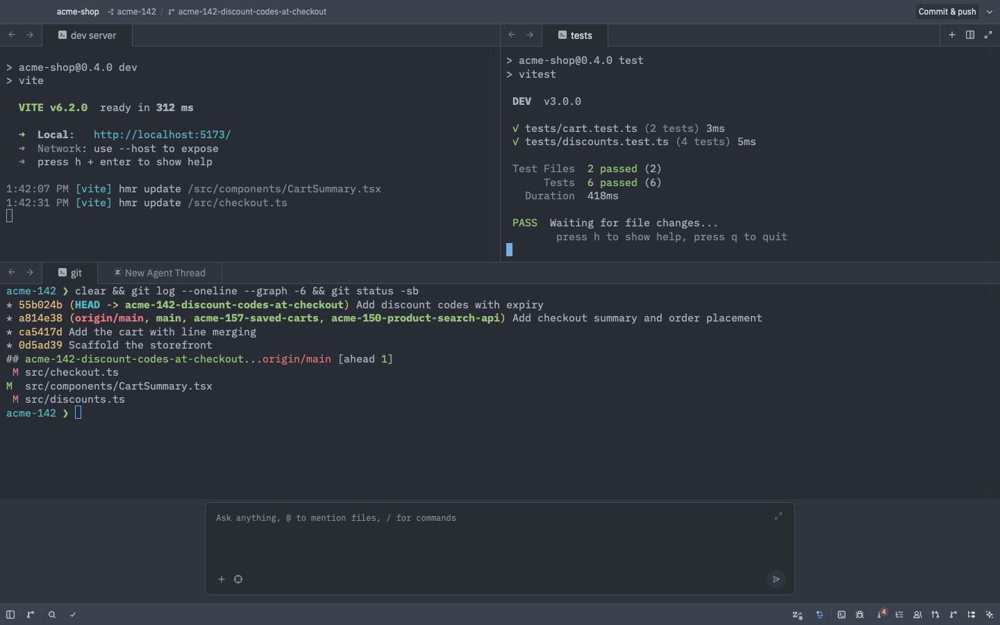

# Terminals



## Terminals that survive restarts

Every shell you open inside an Icarus workspace (the terminal panel, a terminal tab, a layout's terminal, a split) runs on the server, not in the app. The app only shows it.

- Quitting or crashing the app leaves the shell running. When the app comes back, the tab reattaches to the same shell, with the output it printed in the meantime.
- `icarus server restart` and `icarus update install` hand terminals to the new server: processes, background jobs and scrollback stay.
- `icarus server stop` ends every terminal. After a server crash, terminals are lost; the next server lists them as `lost`.
- Closing a tab on purpose kills its shell.

Shells outside Icarus workspaces, and terminals in projects opened over SSH, are ordinary Zed terminals.

A terminal tab is titled like Zed's ("folder — zsh"). A program that sets its own title (for example vim) wins over that, and a name you set wins over both.

## Tasks

Zed tasks (`tasks.json`, `task: spawn`, rerun) started in an Icarus workspace run as server terminals too. Zed's task UI works as usual: status, exit code, rerun. Quitting the app leaves a running task running, and its tab comes back attached. A rerun or closing the tab kills the old one. `icarus terminal list` shows them as `task: <label>`.

## Splits and panes

Terminal splits are Zed panes, so each split can be dragged, resized, zoomed and restored. Each split starts its own shell in the same folder.

| Action | macOS | Linux |
|---|---|---|
| Split right | ⌘D | Ctrl+Shift+D |
| Split down | ⌘⇧D | Alt+Shift+D |
| Next / previous terminal pane (in creation order) | ⌘] / ⌘[ | Ctrl+] / Ctrl+[ |
| Expand (zoom) the pane | ⌘⇧Enter | Ctrl+Shift+Enter |
| Clear | ⌘K | Zed's default |
| Focus the tab group left / right / up / down | ⌥⌘← / → / ↑ / ↓ | none |

With only one tab group, ⌥⌘← and ⌥⌘→ go back and forward in the pane's history instead. `workspace: reset pane sizes` evens out the splits.

### Pane titles

To name a terminal, run `icarus: set pane title` from the command palette (no default key) and type the name. `icarus: clear pane title` removes it. The server keeps the name, so every window and the CLI see it:

```sh
icarus terminal rename <terminal> "Dev server"
icarus terminal rename <terminal>               # clear it
```

## Line editing

macOS terminals translate these keys for readline-style shells:

| Key | Sends |
|---|---|
| ⌘← / ⌘→ | Start / end of line (Ctrl-A / Ctrl-E) |
| ⌘⌫ | Delete to start of line (Ctrl-U) |
| ⌘⌦ | Delete to end of line (Ctrl-K) |
| ⌥← / ⌥→ | Word left / right (Esc b / Esc f) |
| ⌥⌫ | Delete the previous word (Esc DEL) |
| ⌥⌦ | Delete the next word (Esc d); full-screen programs like vim get xterm's own sequence |
| ⌘↑ / ⌘↓ | Scroll to the top / bottom of the scrollback |

On Linux, Ctrl+← / Ctrl+→ move by word and Alt+Backspace deletes the previous word.

### Kitty keyboard protocol

Programs that turn on the kitty keyboard protocol (some editors and TUIs) get every key in its encoding instead of the translations above: modified Enter, Tab, Backspace and Escape arrive distinctly. The server answers the protocol's query, so programs that ask before turning it on work too. Only key presses are reported, not releases or repeats.

## Quick commands

Quick commands are saved terminal commands you can run with one action. Define them in settings:

```json
{
  "quickCommands": [
    { "id": "test", "label": "Run tests", "command": "pnpm test", "appendEnter": true },
    {
      "id": "dev",
      "label": "Dev server",
      "command": "pnpm dev",
      "appendEnter": true,
      "scope": { "type": "project", "remote": "github.com/acme/my-repo" }
    }
  ]
}
```

A command with a `project` scope only shows in the project with that remote. Then:

- `icarus: open quick commands menu` lists them to pick one.
- `icarus: run quick command` runs the workspace's last one again (or the first).

If the command is still running in its terminal, it gets Ctrl-C. Otherwise it's typed into an idle terminal in the window, or a new terminal tab runs it. Neither action has a default key; see [Shortcuts](shortcuts.md#rebinding) to bind one.

## Ports and dev servers

The server watches which ports each workspace's processes listen on, and names them (frontend, API, docs, Storybook, database, cache) from the command line and a short HTTP probe. Cards show them as chips when the `ports` card field is on.

- ⌘⇧B (Ctrl+Shift+B) opens the workspace's running frontend in the browser. The title bar has a button for it too.

```sh
icarus ports list fix-login
icarus ports open fix-login --kind api --browser
```

To name services yourself, set a command that prints them, or rules:

```json
{
  "ports": {
    "labels_command": "mise run print-urls",
    "rules": [
      { "match": { "port": 6006 }, "label": "Storybook", "kind": "storybook" },
      { "match": { "command_regex": "vite" }, "kind": "frontend", "primary": true }
    ],
    "probe": true
  }
}
```

`labels_command` runs in the worktree and prints `label: url` lines, or JSON (`[{"label", "url", "kind"}]` or `{"label": "url"}`).

## icarus terminal

Every server terminal is reachable from the shell, which is how agents and scripts drive them.

```sh
icarus terminal list
icarus terminal create --workspace fix-login --cwd ~/icarus/workspaces/my-repo/fix-login --label server -- pnpm dev
icarus terminal read <terminal>               # the screen
icarus terminal read <terminal> --scrollback  # everything
icarus terminal send <terminal> "pnpm test" --enter
icarus terminal wait <terminal> --contains "ready" --timeout-ms 60000
icarus terminal wait <terminal> --exit
icarus terminal kill <terminal> --remove
```

`--workspace` attributes the terminal to a workspace; `--cwd` sets its folder (the default is the current directory).

To use a server terminal from any other terminal emulator:

```sh
icarus terminal attach <terminal>
icarus terminal attach --create --workspace fix-login --cwd .
```

The attached view replays the screen, then streams output. It reconnects through a server restart, and exits with the shell's exit code. Closing it leaves the shell running.
