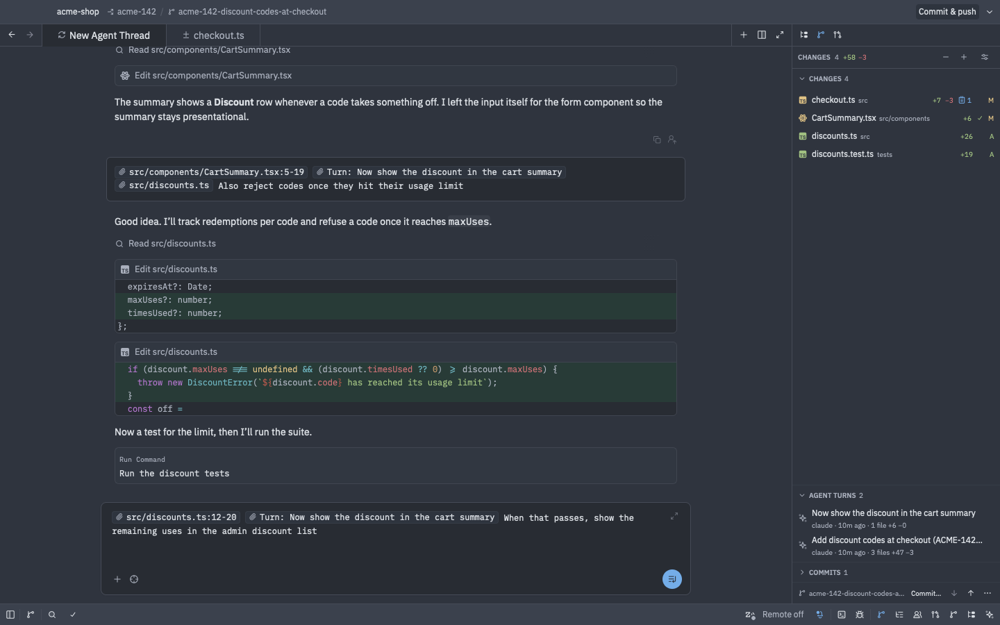

# Agents

Icarus runs your own `claude` (Claude Code) and `codex` binaries with your own logins. The server owns each agent session: closing the app, or restarting it, never stops an agent. When the server itself restarts (for an update, say), agents go to sleep and resume their provider session on the next message.



## Agent tabs

Each agent is a tab in the centre panes, showing its conversation. Tabs can be split, dragged and moved between panes like any other tab.

- To open a new agent tab, press ⌘⌥T (`icarus: new agent`; no default key on Linux). It starts an agent with the default provider in the current workspace.
- To pick the provider, use the **+** above the composer (**New Claude Agent** or **New Codex Agent**), or `icarus: new claude agent` / `icarus: new codex agent`.
- Clicking an agent tab, switching to it with the keyboard, or opening it from a notification puts the cursor in its draft.
- Closing the last agent tab of a workspace opens a fresh one.
- Every new workspace starts with an agent.

To find and reopen an earlier session, run `icarus: open agent history` from the command palette. Type to search what you asked and what the agent answered; Enter resumes the session in an agent tab of its workspace.

## The composer

One composer sits at the bottom of the centre area. It types into the active agent tab, or into the last agent tab you used when another kind of tab is active. Each agent keeps its own draft and attachments, so switching tabs never mixes them up. The line above it says which agent it types to; with several agent tabs open, that agent's tab title and the top edge of its conversation are drawn in the accent colour, even while the cursor is in the composer.

Agent notifications only appear when you aren't looking at that agent's tab: it is in another tab or workspace, or the window isn't in front.

`icarus: focus composer` moves the cursor into it.

### Attachments

Context you attach to an agent shows as a chip in the composer. When you send the message, each chip expands into the prompt.

In the app:

- **Add to agent** on a pull request review thread (in a diff tab or file).
- **Add to agent** on a note, which attaches the whole note conversation.

From the shell (the chip appears in that workspace's composer):

```sh
icarus attach comments fix-login --unresolved --humans-only   # PR review threads, one chip each
icarus attach check fix-login "ci / test"                       # a check, with the failed log tail
icarus attach file fix-login src/auth.ts:40-80                  # a file or line range
icarus attach text fix-login "Error output" < error.log          # any text; reads stdin
icarus attach turn fix-login latest                             # the diff of an agent turn
icarus composer show fix-login
icarus composer clear fix-login
```

## Claude Code and Codex

| | Claude Code | Codex |
|---|---|---|
| Binary | `claude` on `PATH` | `codex` on `PATH` (or `ICARUS_CODEX_BIN`) |
| Login | Your own `claude` login | Your own `codex login` |
| Remote Control | Yes | No |

To choose the default provider for new agents, set it in Settings → Agents, or:

```sh
icarus config set agents.default codex
```

The New workspace dialog has its own Claude / Codex choice, and the CLI takes `--provider`:

```sh
icarus agent create --workspace fix-login --provider codex --prompt "Run the tests and fix failures"
```

To run a different binary or wrapper for a provider, set its command line:

```sh
icarus config set agents.commands.codex '["/opt/codex/bin/codex"]'
```

Agents run with permission prompts bypassed (Codex's "full access"); the app has no permission prompts. `icarus agent create --ask-permissions` starts an agent that asks instead; for Codex that is read-only mode with approval requests declined.

### Modes and models

The composer of an agent tab has a mode picker and a model picker. A change applies to the running session (Claude Code switches at once; Codex from its next turn), and the server keeps it, so the agent restarts in the same mode and model after a sleep or an app restart.

| Claude Code mode | What it does |
|---|---|
| Default | Asks before edits and commands. Nobody answers those questions, so they are denied. |
| Accept Edits | Edits files without asking; other prompts are denied. |
| Plan | Explores and plans without changing anything. |
| Auto | Claude Code decides which actions are safe to run. |
| Don't Ask | Runs only what your Claude Code settings already allow. |
| Bypass Permissions | Runs everything without asking (the default for new agents). |

Codex has three: **Read Only**, **Auto** (edits and commands inside the workspace) and **Full Access** (the default). Approval requests are declined except in Full Access.

The model list is the one Claude Code or Codex reports for your login; until the agent has started once, Claude agents offer the `opus`, `sonnet` and `haiku` aliases.

```sh
icarus agent mode <agent>               # list the modes, * marks the current one
icarus agent mode <agent> plan
icarus agent model <agent> sonnet
icarus agent create --mode acceptEdits --prompt "Tidy the README"
```

### Slash commands

Type `/` in the composer for the agent's slash commands: Claude Code's own (`/compact`, `/context`, `/review`, …), your custom commands and your skills, as Claude Code lists them for its headless mode. A command is sent to the agent as typed. Codex agents have none.

`/remote-control [on|off]` is Icarus's own: Claude Code has no Remote Control in headless mode, so it switches [Remote Control](#remote-control) for that agent and prints the session link. `icarus agent commands <agent>` lists the commands from the shell.

## Working with agents from the shell

```sh
icarus agent list
icarus agent send <agent> "Now add a test for the error case"
icarus agent wait <agent>          # until the current turn ends
icarus agent read <agent>          # the transcript
icarus agent interrupt <agent>     # stop the current turn
icarus agent kill <agent>
icarus agent history --search "rate limit"
icarus agent resume <session>
```

Inside an agent's own shell, `ICARUS_WORKSPACE_ID` and `ICARUS_AGENT_ID` are set, so an agent can run `icarus` commands about its own workspace (for example, leave a note).

## Notes

A note sits on a file and a range of lines in a workspace. Agents use notes to point you at code ("check this branch"); you use them to ask questions about code without disturbing the agent that's working.

Notes show inline in diff tabs and in plain file editors of the workspace, as cards marked NOTE or AGENT NOTE. Rows with a note get a green strip and an icon in the gutter. The Source Control panel shows a badge with each file's open-note count.

To write a note:

1. Select lines in a diff tab or file (or click the **+** in the gutter, or drag over rows).
2. Press ⌘⇧A (Ctrl+Shift+A on Linux).
3. In a diff tab, pick **Agent** in the box's header. (Plain file editors only write notes.)
4. Type and press ⌘Enter, or choose **Add note**.

From the shell, or from an agent:

```sh
icarus notes add src/auth.ts:42-48 "This retry never gives up. Should it?"
icarus notes list
icarus notes show <note>
```

### Replies

When you reply to a note, Icarus starts a separate, short-lived agent session in the worktree to answer it. It gets the whole thread with the current code, and never messages the workspace's running agent. While it works the reply shows "Thinking…"; its answer then appears in the thread with any files it changed (each opens its diff). A failed answer shows the error and **Retry**. Several replies can run at once. The session's transcript stays in session history.

```sh
icarus notes reply <note> "Why not use exponential backoff here?" --wait
```

A reply session that runs longer than `notes.reply_timeout_ms` (default 10 minutes) is stopped.

Notes can also be edited, deleted, resolved (collapsing them to one line), and added to the agent's composer with **Add to agent** (`icarus notes attach <note>`).

## Accounts

Icarus can keep several logins per provider. Each account is its own config folder (`CLAUDE_CONFIG_DIR` or `CODEX_HOME`) under the server's state directory. Icarus never reads, copies or stores credentials: you sign in with the provider's own login command.

The status bar shows the default account's usage (for Claude Code, the fuller of the 5-hour and 7-day windows, for example "Claude 61%"). Its menu lists every account with its meters, switches the default, and adds an account, showing the login command to run with a copy button. The item stays hidden while you only use your normal login and no usage has been reported yet.

```sh
icarus account add claude work     # prints the command that signs in to the new account
icarus account list
icarus account use work            # use it for new sessions
icarus account use system --provider claude   # back to your normal login
icarus account remove work
```

To run one agent or workspace on a specific account, pass `--account <id or label>` to `icarus agent create` or `icarus workspace create`.

## Remote Control

Claude Code's Remote Control lets you follow and drive a session from claude.ai or the Claude app. Icarus starts Claude Code with its own `--remote-control` flag; it's off by default.

- To turn it on for one agent, open its tab and use the Remote Control item in the status bar (`icarus: toggle remote control`), or type `/remote-control` in its composer. Once Claude Code reports the session link, the same menu opens or copies it.
- To turn it on for every new Claude agent, set Settings → Agents → Remote Control for new agents, or `icarus config set agents.remote_control true`.

```sh
icarus agent remote-control on <agent>
icarus agent remote-control off --workspace fix-login
icarus agent list    # shows the claude.ai link
```

An idle agent restarts on its session at once; a busy one switches at its next start.
