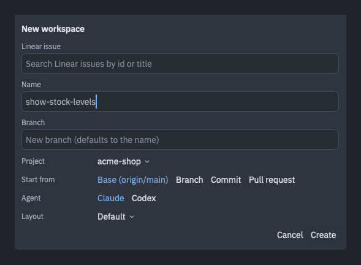
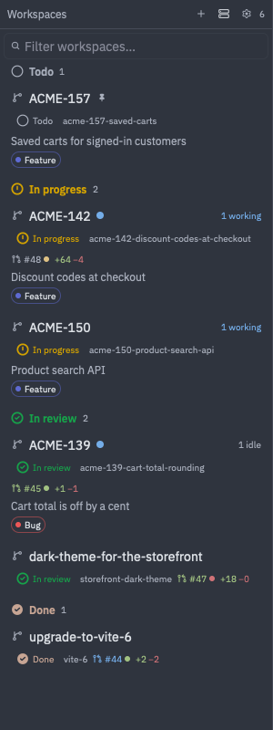

# Workspaces

A workspace is one git worktree with its own branch, agents and terminals. The server owns it, so closing or restarting the app doesn't stop anything inside it.

## Create a workspace



Press ⌘⇧N (Ctrl+Shift+N on Linux), choose **New Workspace…** from the **+** menu in the Workspaces panel, or right-click a project's header (when grouped by project) and choose **New Workspace…**.

| Field | What it does |
|---|---|
| Name | The workspace and folder name. Required unless you link a Linear issue. |
| Branch | The branch to create. Defaults to the name. |
| Server | Only shown when you have saved servers: where the workspace is created. |
| Project | The repository. The window's own project is preselected. |
| Start from | **Base** (the project's base branch), **Branch** (a local branch or `origin/feature`, fetched first when it names a remote), **Commit** (a SHA) or **Pull request** (a number or URL). |
| Agent | Claude or Codex. Defaults to the `agents.default` setting. |
| Layout | The tabs the workspace opens with. See [Layouts](#layouts). |
| Linear issue | Search by id or title; empty shows your open issues. Picking one links it and fills the name (the lowercased id, e.g. `abc-123`) and Linear's branch name. Both stay editable. |
| Setup script | Only shown when the project's setup policy is `ask`: **Run setup** or **Skip**. |

Choose **Create**. While Icarus creates the worktree, the button becomes **Cancel Create** (Escape works too). Cancelling stops any fetch, removes the half-made worktree, and deletes the branch if the create made it. If something fails, the error shows in the dialog and **Create** becomes **Retry**.

### Start from a pull request

The Pull request start point takes a number, `#123`, or a PR URL from the same repository. Icarus looks the PR up with `gh`, fetches its head (fork PRs work too), and creates the worktree on a branch named after the PR's head branch, so the card finds the PR. The base becomes `origin/<the PR's base branch>` and the title becomes the PR's title.

### From the shell

```sh
icarus workspace create --project my-repo fix-login
icarus workspace create --project my-repo --base origin/release --fetch hotfix
icarus workspace create --project my-repo --from-pr 123
icarus workspace create --project my-repo --from-linear ABC-123 --prompt "Implement the issue"
icarus workspace create --project my-repo --from-issue https://github.com/acme/my-repo/issues/42
```

| Option | What it does |
|---|---|
| `--branch <name>` | The branch name (default: the workspace name). |
| `--base <ref>` | Start from this ref instead of the project's base. `--fetch` fetches it first. |
| `--from-pr <n\|url>` | Start from a pull request. |
| `--from-linear <id>` | Link a Linear issue; the name and branch come from it. |
| `--from-issue <url>` | Link a GitHub issue; your [issue command](#issue-command) runs for it. |
| `--prompt <text>` | The agent's first message. |
| `--no-agent` | Don't start an agent. |
| `--account <id>` | Run the agent on this account. See [Accounts](using-agents.md#accounts). |
| `--layout <name>` | Open with this layout. `--pr-url` fills `{pr_url}` when the branch has no PR yet. |
| `--status <id>` | Start in this status column. |
| `--setup` / `--no-setup` | Run or skip the setup script, whatever the policy says. |
| `--trust` / `--always-trust` | Trust the repository's committed scripts. See [Trust](#trusting-committed-scripts). |
| `--no-issue-command` | Don't run the issue command. |
| `--remote-control on\|off` | Start the agent with Claude Code's Remote Control. |

Ctrl-C cancels a create in progress.

## Worktrees made elsewhere

Icarus finds worktrees on its own, the way Orca does. It lists each project's worktrees with `git worktree list`: when the workspace list loads, every 15 seconds while an app is connected, and on `icarus workspace list`. Every worktree that isn't a workspace yet becomes one. That covers worktrees made by Orca, Conductor, Claude Code or plain `git worktree add`. The folder stays where it is. Nothing runs: no setup script, no agent, no new branch. The name is the folder's name, made DNS-safe and unique in the project (`fix-login-2` for a second one). A detached worktree is listed without a branch. The project's main checkout is the project itself, never a workspace. Orca's half-created worktrees (the ones it locks while preparing them) are skipped.

Icarus still creates its own workspaces in `workspace.root`. Discovery never changes where new ones go.

The workspace list never waits for discovery: it shows what Icarus already knows, and worktrees found later show up when the scan ends. If git doesn't answer within 10 seconds, Icarus stops it, keeps that project's workspaces as they were, and tries again a minute later. On macOS this happens with a repository in a protected folder such as ~/Documents until the server is allowed in System Settings › Privacy & Security.

Each workspace has an **origin**. The sidebar marks every origin except native.

| Origin | Where the worktree is |
|---|---|
| `native` | In Icarus's folder (`workspace.root`) |
| `adopted` | Brought in with `icarus workspace adopt` |
| `claude` | `<project>/.claude/worktrees/` (Claude Code) |
| `gsd` | `<project>/.gsd-workspaces/` |
| `custom:<id>` | Under a folder listed in `workspace.worktreeSources` |
| `external` | Anywhere else. Lists group these by parent folder. |

### Which worktrees show

Native and adopted workspaces always show. The others follow these settings:

| Setting | Default | |
|---|---|---|
| `workspace.external` | `hide` | External worktrees, in every project. |
| `project.externalWorktreeVisibility` | | The same choice for one project (`show` or `hide`). Set it in the project's `icarus.local.json`. It wins over `workspace.external`. |
| `workspace.worktreeSources` | `[]` | Your own sources: `[{"id": "conductor", "root": "~/conductor/workspaces"}]`. At most 32. |
| `workspace.sourceVisibility` | | `show` or `hide` per source id (`claude`, `gsd` or one of yours). Sources are hidden unless set to `show`. |
| `project.worktreeVisibilitySourcePreferences` | | Per project: `{"builtIn": {"claude": "show"}, "custom": {"conductor": "show"}}`. |
| `project.agentWorktreeVisibility` | | Per project, for `claude` and `gsd` when the project sets no source preference. |

For each worktree, the first match decides:

1. Your own choice for that worktree (**Show**, **Hide**, `icarus workspace hide` or `unhide`).
2. The project's setting.
3. The default.

A hidden workspace is left out of the sidebar, the rules and PR polling, but Icarus still knows it: `icarus workspace list --all` lists it marked `hidden`.

Importing Orca settings carries this over. `worktreeVisibilityDefaults` becomes `workspace.external`, `workspace.worktreeSources` and `workspace.sourceVisibility`. Each repo's `externalWorktreeVisibility` and source preferences go to that project's `icarus.local.json`. Orca's export leaves out the folders of custom sources, so add their `root` yourself.

Orca shows external worktrees in repos added before it began hiding them, and it records that as the repo's `externalWorktreeVisibility: "show"`. Icarus has no such legacy rule, since it never showed worktrees it hadn't made or adopted. A new project hides external worktrees, and a project whose Orca repo showed them keeps showing them through the imported setting.

### New worktrees inbox

While a project hides external worktrees, the external and custom-source worktrees found since you last looked wait in a **New worktrees** row at the top of the project's group. Each one offers **Show**, **Hide**, and **Show all from this source**. That last option sets the project's setting for the source, for example `project.externalWorktreeVisibility: "show"`. Claude Code and GSD worktrees stay out of the inbox, as in Orca.

```sh
icarus workspace inbox
icarus workspace unhide fix-login                 # show it
icarus workspace hide fix-login
icarus workspace unhide fix-login --follow-settings
icarus workspace show-source external --project my-repo
```

### Removed elsewhere

When git stops listing a worktree (someone ran `git worktree remove`), its workspace drops out. Icarus keeps the record, keyed by the folder. If a worktree comes back at the same path, it gets its old record back, with its status, notes and show/hide choice.

### Adopt a worktree from another clone

Discovery only sees the project's own repository. To bring in a worktree of another clone of the same repository, use adopt:

```sh
icarus workspace adopt ~/other-clone-worktrees/fix-login
icarus workspace adopt ../fix-login --project my-repo --name login
```

Icarus matches the worktree's repository to a project, first by its main checkout and then by its remote. `--project` picks the project yourself. The branch is whatever the worktree has checked out. Adopting a worktree that discovery already found keeps its record and shows it, whatever the settings say. Adopt refuses a main checkout (add that with `icarus project add`), a detached HEAD, and a folder that is already a workspace.

## Naming

The folder is `<workspace root>/<project>/<slug>`, where the slug is the name made DNS-safe (lowercase letters, digits and dashes), so `<slug>.localhost` dev URLs work. The workspace root is `~/icarus/workspaces` unless you set `workspace.root` (read when the server starts).

To give a card a friendlier title without renaming anything, right-click it and choose **Rename**, or:

```sh
icarus workspace set fix-login --title "Fix the login redirect"
```

## Setup and archive scripts

A setup script runs when a workspace is created; an archive script runs before one is removed. Both live under `project.hooks.scripts` (`setup` and `archive`):

- **Shared** (committed): in the repository's `icarus.json`.
- **Local** (yours): in `icarus.local.json` or your user settings.

`project.hooks.commandSourcePolicy` picks which run: `shared-only`, `local-only` or `run-both`. Unset means the local script wins when there is one.

The setup script runs in a terminal tab titled **Setup**, through `bash` with `set -e`, in the new worktree. The tab stays a usable shell afterwards. These variables are set:

| Variable | Value |
|---|---|
| `ICARUS_ROOT_PATH` | The repository's main checkout. |
| `ICARUS_WORKTREE_PATH` | The new worktree. |
| `ICARUS_WORKSPACE_NAME` | The workspace name. |
| `ICARUS_WORKSPACE_ID` | The workspace id. |

While it runs the card shows **Setting up**; if it fails, **Setup failed** with the reason in a tooltip. To run it again, right-click the card and choose **Re-run Setup**, or run `icarus workspace setup <workspace>`.

The archive script runs in the worktree with the same variables and a 120-second timeout. If it fails, the workspace is kept, unless you force the removal.

Policies (in `project.hooks`, any layer):

| Key | Values |
|---|---|
| `setupRunPolicy` | `run-by-default` (default), `skip-by-default`, `ask` |
| `setupAgentStartupPolicy` | `start-immediately` (default) or `wait-for-setup`: the agent exists at once, but its first prompt waits until setup ends. |
| `setupTimeoutMs` | Stop the setup script after this long. No limit by default. |
| `archiveTimeoutMs` | Default 120000. |

Example `icarus.local.json`:

```json
{
  "project": {
    "hooks": {
      "scripts": { "setup": "pnpm install" },
      "setupAgentStartupPolicy": "wait-for-setup"
    }
  }
}
```

### Issue command

`project.hooks.issueCommand` in `icarus.local.json` or your user settings runs in an **Issue command** terminal when a workspace is linked to a GitHub pull request or issue. `{{issue}}` and `{{artifact_url}}` are filled in, for example `gh issue view {{issue}}`. Linear issues don't run it.

### .worktreeinclude

List gitignored files to copy into every new worktree (for example `.env`), one repository-relative path per line, in `.worktreeinclude` at the repository root. Copies are private (copy-on-write clones where the filesystem supports them). Globs and `!` negations aren't supported. Problems are reported as warnings; they never fail the create.

## Trusting committed scripts

Committed scripts (setup and archive from `icarus.json`) only run after you trust that exact content. Local scripts need no trust.

When you create a workspace in a project with untrusted scripts, the dialog shows them with **Trust and Create**, **Create without running them** and **Back**. Tick **Always trust scripts from …** to trust every later version too. If the scripts change, Icarus asks again.

From the shell:

```sh
icarus project scripts my-repo           # show the scripts and whether they're trusted
icarus project trust my-repo             # trust them as they are now
icarus project trust my-repo --always    # trust every later version too
icarus project untrust my-repo           # forget all trust
```

A create with untrusted setup scripts fails with `untrusted_scripts` unless you pass `--trust`, `--always-trust` or `--no-setup`. An untrusted archive script is skipped, and the removal goes ahead.

## The sidebar



The Workspaces panel lists every workspace as a card. Click a card to open its workspace.

### Group and sort

Open the gear (View) menu in the panel header.

| Group by | Setting value | Sections |
|---|---|---|
| Status | `workspace-status` | Your status columns. Only columns with workspaces show. |
| PR | `pr-status` | Done (merged), In review (open), In progress (no PR or a draft), Closed. |
| Stack | `stack` | One section per stack, then "Not in a stack". A stack is a GitHub stack, or open PRs each based on the branch of the one below. **Stack from main up** flips the order inside a stack. |
| Project | `repo` | One section per project, including empty ones. This is the default. |
| None | `none` | One list. |

| Sort by | Setting value | Order |
|---|---|---|
| Name | `name` | Alphabetical by title. |
| Agent Activity | `smart` | Needs your input first, then working agents, then unread, then by last activity. |
| Recent | `recent` | Last activity (an agent turn, terminal output, or a git action). The default. |
| Project | `repo` | By project. |
| Manual | `manual` | Your drag order. |

The same choices are the settings `sidebar.groupBy` and `sidebar.sortBy`:

```sh
icarus config set sidebar.groupBy pr-status
icarus config set sidebar.sortBy smart
```

Click a section header to fold its cards away; click it again to show them. Each grouping remembers its folded sections in this app's `client.json` (`sidebar.collapsedGroups`).

Clicking a card shows that workspace: the window already showing it comes to the front, otherwise the front window switches to it.

### Filter

Type in the filter box under the panel header, or press ⌘F (Ctrl+F) while the panel has focus. Every word must match the name, title, branch, PR number (`#42`) or title, or the Linear issue id or title. Escape clears it.

To jump to any workspace from anywhere, press ⌘J (Ctrl+J) for the workspace switcher.

### Pin

Right-click a card and choose **Pin**. Pinned cards lead their group (inside a stack, the stack order wins) and show a pin icon.

```sh
icarus workspace set fix-login --pin
icarus workspace set fix-login --unpin
```

### Select several cards

⌘-click (Ctrl-click on Linux) toggles a card; ⇧-click selects a range. Right-click a selected card to **Pin**, **Unpin**, **Sleep**, **Wake** or **Delete** all of them at once.

### Drag to reorder

Drag a card onto another to move it there. This switches the sort to Manual. When grouped by status, dropping a card into another status moves it to that status.

```sh
icarus workspace reorder fix-login add-tests   # put these at the top, in this order
```

### Unread

A workspace becomes unread when one of its agents finishes a turn or asks for input while you're not looking at it. The card shows a dot: the accent colour when an agent finished, a warning colour when it needs you. Opening the workspace clears it.

```sh
icarus workspace mark-read fix-login
icarus workspace mark-unread fix-login
```

### Status

Click a card's status chip to move it to another status column. Statuses are configured in Settings → Statuses; see [Automations](automations.md#statuses).

```sh
icarus workspace set fix-login --status in-review
```

## Card fields

Choose what cards show in the View menu's **Card** list, or with ⌘K C followed by a number (Ctrl+K C on Linux):

| Key | Field id | Shows |
|---|---|---|
| 1 | `unread` | The unread dot. |
| 2 | `workspace-status` | The status chip, in groupings other than Status (grouped by status, the section header says it). Older settings may call it `status`; both work. |
| 3 | `inline-agents` | The agent row: the latest agent's finished turn in one line, or a pill with the lead agent and how many more. Click it to list every agent. |
| 4 | `pr` | The pull request icon before the title, coloured by state (number, checks and merge queue on hover), and a Merge queue chip. |
| 5 | `pr-author` | The PR author's avatar. |
| 6 | `pr-diff` | The PR's +N −M. |
| 7 | `stack` | The position in its stack, such as 2/2. |
| 8 | `linear-title` | The Linear link, the issue's labels and its title. |
| 9 | `ports` | Running services. See [Ports](terminals.md#ports-and-dev-servers). |
| 0 | `project` | The project name. |

The shared setting is `workspace.cardFields`. Toggling a field in the app writes the app's own `client.json`, so each app can show different fields; **Use Shared Card Fields** in the View menu drops that override.

```sh
icarus config set workspace.cardFields '["unread","inline-agents","pr","ports"]'   # every app
icarus app config set workspace.cardFields '["pr","ports"]'                       # this app only
```

## Sleep, wake and delete

Right-click a card:

- **Sleep** puts its agents to sleep and stops its terminals' processes. Screens and scrollback stay. The card shows a moon and a dimmed title, as do worktrees found on disk that have no PR and no agents.
- **Wake** restarts exactly what was put to sleep. A sleeping agent also wakes on its next message.
- **Delete** runs the archive script, then removes the worktree and the branch. Icarus refuses when the worktree has uncommitted changes, when you have unsent review comments on its pull request, or when the archive script fails. It says why and offers **Force Delete**.
- A worktree Icarus didn't create (any origin but native, or one found in its folder) is never deleted by accident. Removing it only hides it and stops its agents and terminals. `--delete-worktree` deletes it. Its branch is then kept unless you also pass `--delete-branch`.

```sh
icarus workspace sleep fix-login
icarus workspace wake fix-login
icarus workspace remove fix-login
icarus workspace remove fix-login --keep-branch
icarus workspace remove fix-login --force                  # ignore local changes and a failed archive script
icarus workspace remove fix-login --skip-archive
icarus workspace remove fix-login --allow-failed-archive   # still refuses local changes
icarus workspace remove orca-fix --delete-worktree         # a discovered worktree; its branch stays
```

## Layouts

A layout is the arrangement of tabs a workspace opens with. Two are built in:

- `default`: one agent tab.
- `review`: the agent on the left; on the right, the first changed file's diff and the pull request in a browser tab.

Define your own under `layouts` in settings. A layout is a pane (`{tabs, active}`) or a split (`{split: "row" | "column", children, sizes}`).

| Tab | Fields |
|---|---|
| `agent` | `prompt` (starts a new agent with it), `provider` |
| `browser` | `url`, with `{pr_url}`, `{preview_url}`, `{frontend_url}` or `{workspace_path}` |
| `diff` | `path` (a file's diff; `{first_changed_file}` works), or none for the Source Control panel; `scope` |
| `explorer` | none |
| `file` | `path`, `line` |
| `terminal` | `command` |

```json
{
  "layouts": {
    "dev": {
      "split": "row",
      "sizes": [0.6, 0.4],
      "children": [
        { "tabs": [{ "type": "agent" }] },
        {
          "split": "column",
          "children": [
            { "tabs": [{ "type": "terminal", "command": "pnpm dev" }] },
            { "tabs": [{ "type": "browser", "url": "{frontend_url}" }] }
          ]
        }
      ]
    }
  }
}
```

```sh
icarus layout list
icarus layout show review
icarus workspace create --project my-repo --layout dev new-page
icarus workspace layout new-page review   # rearrange an existing workspace
```

## The next-action button

The title bar's next-action button shows the workspace's next step and runs it: **Commit & push**, **Create PR**, **Ready for review**, **Resolve conflicts**, **Merge**, **Add to merge queue**, **Turn on auto-merge**, **Merge stack**, and so on. Steps that need code changes go to the agent with a prompt (you can change the prompts in Settings → Top bar action prompts); merge steps call GitHub directly.

Press ⌘⌥Enter (Ctrl+Alt+Enter on Linux), or:

```sh
icarus workspace next-action fix-login
icarus workspace next-action fix-login --run
```
